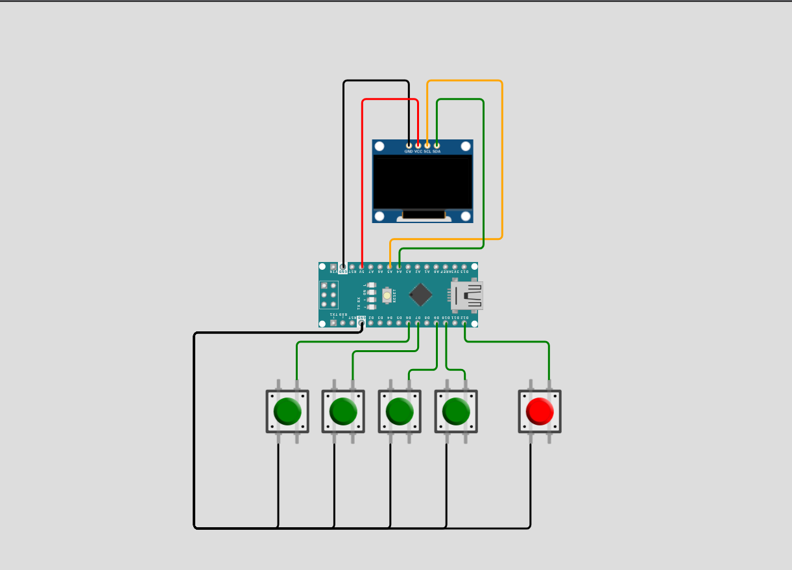

# Arduino Karate Champ 🥋

<p align="center">
  
</p>

<p align="center">
  
  
  
  
</p>


<p align="center">
  <a href="#overview-">Overview🦤</a> •
  <a href="#features-">Features✨</a> •
  <a href="#installation-">Installation🐧</a> •
  <a href="#hardware-">Hardware🪿</a> •
  <a href="#contribution-">Contribute🤝</a> •
  <a href="#developer-guidelines-">Developer Guidelines 🐳</a>
</p>

---

## Overview 🐢

Karate Champ is a side-view fighting game for Arduino. Step into the dojo, close the distance, trade blows, and drain your rival's health bar before the 90-second round timer runs out.

Each fighter has a full moveset: walk, punch, front kick, back kick, left and right blocks, and low sweeps. Attacks only hurt on their active animation frames, so timing matters. Hit too early or too late, and you whiff, and a well-timed block cuts incoming damage to a quarter. If time expires, the fighter with more health takes the round, and the match ends when one fighter leads by two round wins.

Your opponent doesn't follow a fixed script. The AI reads the fight state (positions, health, current moves, and time left) and chooses its next action by sampling rather than always picking the top option. That keeps it unpredictable and harder to exploit with a single repeated trick.

---

## Features 🦤
- **Full Fighting Moveset** - Walk forward and backwards, punch, front kick, back kick, left and right blocks, and left and right low sweeps, all from just five buttons using combos
- **Frame-Accurate Combat** - Attacks only deal damage on their active animation frames, using hitbox and hurtbox collision detection, so timing and spacing matter
- **Blocking System** - A successful block cuts incoming damage to a quarter (minimum 1)
- **Different Damage Per Move** - Punch deals 8, sweep 10, front kick 12, and back kick 15, so slower, riskier moves hit harder
- **Neural Network AI Opponent** - Reads positions, health, current moves, animation frames, and time left, then picks its next action by sampling, which makes it less predictable and harder to exploit
- **Round-Based Matches** - 90-second rounds with a live timer. If time runs out, the fighter with more health wins the round, and the match ends when one fighter leads by two round wins
- **Health Bars and Timer HUD** - Both fighters' health and the countdown are shown at the top of the screen
- **Round and Game Over Screens** - Winner announcements between rounds, a final tally, and press any button to restart
- **Smooth Sprite Animation** - Multi-frame animations for every move, stored in PROGMEM
- **Memory-Efficient Graphics** - Player 2 reuses Player 1's sprites, mirrored at runtime with `flipXBMH()`, so no second set of bitmaps is needed
- **Button Debouncing** - Input state changes are debounced with `millis()` instead of `delay()`, keeping controls responsive
- **Compact & Efficient** - Runs on an Arduino Nano with an SH1106 OLED over I2C

---

## Installation 🐧

### Prerequisites
- **Arduino IDE 1.8.x or higher** ([Download here](https://www.arduino.cc/en/software))
- USB cable (USB-A to USB-B for Uno, or appropriate for your board)
- Git (optional, for cloning method)

---

### Method 1: Download from GitHub Release (Easiest)

#### Step 1: Download the Code
1. Visit the [Releases page](https://github.com/aydakikio/arduino_karate_champ/releases)
2. Click on the latest release
3. Download the **arduino_karate_champ.ino** and  **karate_ai.h** files

#### Step 2: Install U8g2 Library
1. Open **Arduino IDE**
2. Go to **Sketch → Include Library → Manage Libraries...**
3. Search for `U8g2`
4. Install **U8g2 by olikraus**

#### Step 3: Open the Project
1. **File → Open**
2. Select `arduino_karate_champ.ino`

#### Step 4: Configure Arduino
1. Connect Arduino via USB
2. **Tools → Board → Arduino Uno**
3. **Tools → Port** → Select your Arduino port

#### Step 5: Upload
1. Click **Upload** (→) or press `Ctrl+U`
2. Game starts immediately!

---

### Method 2: Clone from GitHub

```bash
# Clone repository
git clone github.com/aydakikio/arduino_karate_champ.git
cd arduino_chess/

# Open in Arduino IDE
# File → Open → source_code/arduino_karate_champ.ino
```

Then follow Steps 2-5 from Method 1.

---

## Hardware 🪿

### Required Components
- **Arduino Nano** (or compatible)
- **128x64 OLED Display** (SSD1306/SH1106, I2C)
- **5x Push Buttons**
- **Breadboard and jumper wires**

### Wiring

| Component   | Arduino Pin |
|-------------|-------------|
| OLED SCL    | A5          |
| OLED SDA    | A4          |
| BTN_ACTION  | 12          |
| BTN_UP      | 6           |
| BTN_DOWN    | 9           |
| BTN_LEFT    | 7           |
| BTN_RIGHT   | 10          |

<p align="center">
  
</p>

---

## Known Issues 🐛

- **Combo timing** - Buttons are read one state at a time, so pressing Action a split second before a direction triggers a plain punch instead of a kick or sweep. Press the buttons together.
- **No push collision** - Fighters can walk through each other. Sprites don't turn around when they swap sides, and hitboxes always assume Player 1 faces right and Player 2 faces left.
- **Blocks are not directional** - Either block button reduces damage from any attack, including sweeps.
- **No round cap** - The match only ends when one fighter leads by two rounds. A draw awards no point, so a long run of draws or alternating wins can keep the match going. `MAX_ROUND_COUNT` is defined but not currently used.
- **Instant restart on Game Over** - Any button restarts the game, so a button still held from the fight can skip the Game Over screen.
- **Possible sprite tearing or fast movement** - The display uses U8g2 page-buffer mode, which runs the drawing code several times per frame. Animation and movement code (`play_walking()` and the other `play_*` functions) lives inside that loop, so a sprite may shift between display bands or move faster than intended.
- **Sweep direction mapping unverified** - The left and right sweep sprite assignments for Player 2 are marked in the code as needing more checks.
- **Display flickering** - Some clone boards may flicker. Try adjusting the U8g2 constructor or the loop timing.
- **I2C address** - If the display doesn't initialize, try address 0x3D instead of 0x3C.
- **Memory constraints** - The Nano has 2KB of SRAM. The mirror buffer, sprites, and `karate_ai.h` take up a large share of memory, so large modifications may cause instability.
- **Missing AI header** - `karate_ai.h` must be in the same folder as the sketch, or it won't compile.

---

## Contribution 🤝

We welcome contributions from the community. Before submitting, please review the guidelines below to ensure your contribution can be integrated smoothly.

### How to Contribute

**For Code Contributions:**
1. Clone the repository: `git clone github.com/aydakikio/arduino_karate_champ.git`
2. Create a feature branch: `git checkout -b feature/descriptive-name`
3. Implement your changes following the coding standards in Developer Guidelines
4. Test thoroughly on physical hardware
5. Commit with descriptive messages: `git commit -m "Fix: Resolve AI choose only sweep"`
6. Push to your branch: `git push origin feature/descriptive-name`
7. Submit a Pull Request with a clear description of changes and testing performed

**Pull Request Requirements:**
- Code compiles without warnings
- Tested on actual Arduino hardware
- Follows existing code style and naming conventions
- Includes comments for complex logic
- No debug code or commented-out sections

---

## Bug Reports 🐛

Found a bug? A clear report makes it much easier to reproduce and fix. Please open an issue and include the details below.

**Required Information:**

```markdown
## Bug Description
[Clear, concise description of the issue]

## Reproduction Steps
1. [First step]
2. [Second step]
3. [Additional steps...]

## Expected Behavior
[What should happen]

## Actual Behavior
[What actually happens]

## Game Context
- **Round / Timer:** [e.g., Round 2, 45 seconds left]
- **Player 1 Move:** [Button combo you were pressing, e.g., Right + Up + Action]
- **Player 2 (AI) Move:** [What the AI was doing, if known]
- **Fighter Positions / Health:** [Approximate x positions and health values, if relevant]
- **Reproducibility:** [Always / Sometimes / Once]

## Hardware Configuration
- **Board:** [Arduino Nano / Uno R3 / Other]
- **Display Controller:** [SSD1306 / SH1106]
- **Display Resolution:** [128x64]
- **Interface:** [I2C (address: 0x3C / 0x3D)]
- **Buttons:** [Pin configuration and wiring, note any deviations from the default]

## Software Environment
- **Arduino IDE:** [Version number, e.g., 1.8.19 / 2.0.3]
- **U8g2 Library:** [Version, e.g., 2.34.22]
- **Board Package:** [Version if using third-party boards]
- **OS:** [Windows 10 / macOS 13 / Ubuntu 22.04]
- **karate_ai.h Version:** [Release or commit, if you changed or regenerated it]

## Build Information
- **Sketch Size:** [e.g., 18,432 bytes (56%) of program storage]
- **Global Variables:** [e.g., 1,247 bytes (60%) of dynamic memory]
- **Compiler Warnings:** [Yes/No, include if present]

## Serial Output / Error Messages

[Paste any error messages or serial monitor output here]

## Additional Context
- Modified code sections (if any)
- Photographs or a short video of the screen showing the issue
- Photographs of your physical setup and wiring

## Attempted Solutions
[What you've already tried to fix the issue]
```

**Tips for a good report:**

- **One bug per issue.** Separate problems are easier to track and fix.
- **Check Known Issues first.** Your problem may already be listed with a workaround.
- **Report memory problems with numbers.** If the game freezes, resets, or glitches, include the global variable usage from the compiler output, since the Nano has only 2KB of SRAM.
- **Note AI behavior carefully.** The AI samples its moves randomly, so describe what it did and how often, rather than just saying it behaved oddly.

---

### Feature Requests

Have an idea for the game? Open an issue describing:

- **Use case and benefits** - What problem it solves or what it adds to gameplay
- **Proposed implementation approach** - How you would build it, including any changes to the state machine, hitboxes, or `karate_ai.h`
- **Memory/performance impact assessment** - Estimated change in flash and SRAM use, and any effect on frame rate. The Nano has only 2KB of SRAM, so every extra sprite, buffer, or variable matters
- **AI compatibility** - Whether the change alters the inputs or actions the neural network expects. New moves or state values may require retraining and regenerating `karate_ai.h`
- **Hardware compatibility considerations** - Extra buttons, pins, or components needed, and whether it still works with the default wiring

---

### Contribution Areas

**High Priority:**
- Fixing the page-buffer issue where movement and animation logic runs inside the `firstPage()`/`nextPage()` drawing loop
- Memory usage reduction (SRAM, sprite storage, and the flip buffer)
- Critical bug fixes (hitbox accuracy, combo input, round logic)
- Hardware compatibility fixes

**Accepted Contributions:**
- Fighters turning to face each other when they swap sides, with matching hitbox flipping
- Push collision so fighters can't walk through each other
- Directional blocking (high vs. low) so sweeps and strikes are blocked differently
- A hard round cap using `MAX_ROUND_COUNT` and a clear rule for draws
- Improved AI (better training data, difficulty levels, retraining tools and scripts)
- Two-player (local) mode, using a second set of buttons for Player 2
- Additional moves (jump, throw, special attacks)
- Combo input buffering for easier move entry
- Sound/buzzer integration for hits, blocks, and round start
- Additional display driver support (SSD1306 and others)
- Control scheme alternatives
- Win/loss and round statistics screen

**Documentation:**
- Controls table with the button combo for every move
- Wiring diagrams and schematics
- Sprite creation guide (making XBM bitmaps and adding animation frames)
- Documentation for training and exporting the AI into `karate_ai.h`
- Troubleshooting guides
- Platform-specific setup instructions
- Code architecture documentation

---

## Developer Guidelines 🐳

### Code Structure
```cpp
// Includes (U8g2, karate_ai.h)
// Hardware configuration (display, buttons)
// Constants (#define), screen size, timing, round settings
// Sprite bitmaps (PROGMEM)
// Game state variables, Player struct, Box struct
// Forward declarations
// setup(), setup_game() and loop()
// Input handling (handle_inputs)
// Round logic (update_round)
// AI (update_ai, atk_type)
// Collision detection (hurtbox, hitbox, damage)
// Graphics helpers (flipXBMH)
// Per-move draw functions (draw_player_1_*, draw_player_2_*)
// Per-move animation functions (play_*)
// draw_player_1/2, HUD, round end and game over pages
```

### Naming Conventions
- **Variables:** `snake_case` (round_timer, player_1, last_round_winner)
- **Constants:** `SCREAMING_SNAKE_CASE` (BTN_PLAYER_1_ACTION, ROUND_MAX_TIME, ANIMATION_SPEED)
- **Functions:** `snake_case` (check_collision, update_ai, draw_healthbars)
- **Sprites:** `snake_case` ending in `_bits` (back_kick_frame_1_bits)
- **Draw and animation functions:** `draw_player_<n>_<move>()` renders frames, `play_<move>()` advances the animation

### Key Structures

**Player State:**
```cpp
struct Player {
  int health;
  int x;
  uint8_t state;          // current move (see state table)
  uint8_t frame;          // current animation frame
  uint32_t anim_last_time;
  uint8_t prev_state;     // detects state changes, 255 = none
  bool locked;            // true during attack animations
  uint32_t last_pressed_time;
};
```

**State IDs:**

| State | Move | Player 1 Input |
|-------|------|----------------|
| 0 | Idle | none |
| 1 | Walk backward | Left |
| 2 | Walk forward | Right |
| 3 | Punch | Action |
| 4 | Front kick | Right + Action |
| 5 | Back kick | Left + Action |
| 6 | Block (right) | Right + Up + Action |
| 7 | Block (left) | Left + Up + Action |
| 8 | Sweep (left) | Left + Down + Action |
| 9 | Sweep (right) | Right + Down + Action |

These IDs are shared by input, animation, collision, and the AI network, so changing them has wide effects.

### Core Patterns

**Input Handling:**
```cpp
uint8_t ns;
if      (right && down && action) ns = 9;
else if (left  && down && action) ns = 8;
// ... most specific combos first, single buttons last
else                              ns = 0;

// Debounce only on state changes, not every frame
if (ns != player_1.state) {
  if (now - player_1.last_pressed_time < DEBOUNCE_MS) return;
  player_1.last_pressed_time = now;
}
player_1.state = ns;
```
Check the most specific combo first, or a simple press will hide it.

**Attack Animation (locked state):**
```cpp
void play_punching(bool is_player_1) {
  Player& player = is_player_1 ? player_1 : player_2;

  if (player.state != player.prev_state) {   // new move started
    player.frame = 0;
    player.anim_last_time = millis();
    player.prev_state = player.state;
    player.locked = true;                    // ignore input until finished
  }

  if (millis() - player.anim_last_time >= ANIMATION_SPEED) {
    player.frame++;
    player.anim_last_time = millis();
    if (player.frame >= 5) {                 // animation finished
      player.locked = false;
      player.state = 0;
      player.prev_state = 255;
      player.frame = 0;
      return;
    }
  }

  if (is_player_1) draw_player_1_punching(player.frame);
  else             draw_player_2_punching(player.frame);
}
```
Every player function takes `is_player_1` so one animation routine serves both fighters.

**Hitboxes and Damage:**
```cpp
// Hitbox exists only on active frames
case 3: // punch
  if (p.frame == 3 || p.frame == 4)
    return { faces_right ? p.x + 13 : p.x - 8, SCREEN_HEIGHT - 18, 8, 8 };
```
Hitbox frames in `get_hitbox()` and damage frames in `get_attack_damage()` must always match.

| Move | Active Frames | Damage |
|------|---------------|--------|
| Punch | 3-4 | 8 |
| Front kick | 2-3 | 12 |
| Back kick | 3 | 15 |
| Sweep | 1-3 | 10 |

**Sprite Mirroring (Player 2):**
```cpp
// Player 1: draw straight from flash
u8g2.drawXBMP(player_1.x, SCREEN_HEIGHT-24, 13, 24, player_walking_passing_pose_bits);

// Player 2: flip into RAM buffer, then draw from RAM
flipXBMH(player_walking_passing_pose_bits, flipBuf, 13, 24);
u8g2.drawXBM(player_2.x, SCREEN_HEIGHT-24, 13, 24, flipBuf);
```
Use `drawXBMP` for PROGMEM data and `drawXBM` for the RAM buffer. `flipBuf` is 66 bytes, which fits the largest sprite (17x22). A larger sprite needs a bigger buffer.

**AI Integration:**
```cpp
uint8_t action = kai_choose_action_sampled(
    0,                    // AI controls P2
    player_1.x, player_2.x,
    player_2.health, player_1.health,
    player_2.state, player_2.frame,
    player_1.state, player_1.frame,
    time_left,            // remapped to 0-127
    ai_last_atk,          // 0 none, 1 punch, 2 front kick, 3 back kick, 4 sweep
    (uint16_t)random(0, 65536)
);
```
The AI runs every `AI_UPDATE_INTERVAL` (167 ms), skips while `player_2.locked`, and returns the same state IDs the player uses. Changing its inputs, the state IDs, or the move set means retraining and regenerating `karate_ai.h`.

**Game State Management:**
```cpp
void loop() {
  if (!game_over) {
    if (showing_round_end) { draw_round_end_page(); return; }

    handle_inputs();
    update_ai();
    check_collision();
    update_round();
    draw_game();
  } else {
    draw_game_over_page();
    // any button -> setup_game(true)
  }
}
```

**U8g2 Display:**
```cpp
U8G2_SH1106_128X64_NONAME_2_HW_I2C u8g2(U8G2_R0, -1, A5, A4);
// _2_ = page-buffer mode (low RAM)

void draw_game() {
  u8g2.firstPage();
  do {
    draw_player_2();
    draw_player_1();
    draw_healthbars();
  } while (u8g2.nextPage());
}
```

### Adding a New Move
1. Create the sprite frames as XBM bitmaps in PROGMEM and note each width and height.
2. Check that the largest frame fits `flipBuf`.
3. Add `draw_player_1_<move>()` and `draw_player_2_<move>()` functions.
4. Add a `play_<move>()` function with its frame count and locking behavior.
5. Add a new state ID in `handle_inputs()`, `draw_player_1()` and `draw_player_2()`.
6. Add the hitbox in `get_hitbox()` and damage in `get_attack_damage()`.
7. Update `atk_type()` if it is an attack, and check the AI still behaves.
8. Update the controls table and state table in this README.

### Best Practices

**Memory Management:**
- Arduino Nano: 32KB Flash, 2KB SRAM
- Store all sprites in PROGMEM and read them with `drawXBMP()` or `pgm_read_byte()`
- Reuse mirrored sprites instead of storing a second set
- Keep globals small, and avoid dynamic allocation and `String`
- Check the compiler's global variable usage after every change

**Performance:**
- Use `millis()` for all timing, never `delay()`
- Keep `loop()` fast. Input, AI, collision, and drawing all run every iteration
- Update game logic outside the `firstPage()`/`nextPage()` loop where possible, because the draw loop runs several times per frame in page-buffer mode
- Tune `ANIMATION_SPEED` and `AI_UPDATE_INTERVAL` through the constants, not hardcoded numbers

### Testing Checklist
- [ ] Compiles without errors or warnings
- [ ] Every button combo triggers the correct move
- [ ] Attacks deal damage only on their active frames, and only once per attack
- [ ] Blocking reduces damage to a quarter (minimum 1)
- [ ] Locked animations can't be interrupted, and idle resumes afterwards
- [ ] Fighters stay inside the screen bounds
- [ ] Player 2 sprites mirror correctly with no artifacts
- [ ] The AI picks valid moves and attacks without freezing
- [ ] The timer counts down, and time-up awards the round to the healthier fighter
- [ ] Round end, next round, and game over screens appear correctly
- [ ] The game resets cleanly after game over
- [ ] SRAM usage stays within safe limits for the Nano

### Common Pitfalls
❌ Don't forget to reset `prev_state = 255` and `locked = false` when an animation ends  
❌ Don't change hitbox frames without changing damage frames (and the reverse)  
❌ Don't pass a sprite larger than `flipBuf` to `flipXBMH()`  
❌ Don't mix up `drawXBMP` (flash) and `drawXBM` (RAM)  
❌ Don't change state IDs, inputs, or the move set without retraining the AI  
❌ Don't put long-running or `delay()` code in `loop()`  
❌ Don't put new game logic inside the `firstPage()` drawing loop  
✅ Use `millis()` for timing and debouncing  
✅ Check the most specific button combos first  
✅ Use `PROGMEM` for all sprite bitmaps  
✅ Keep sprite width and height in the draw call matched to the bitmap  
✅ Test on real hardware, since the Nano's memory limits are easy to hit  

---
<p align="center">
  <a href="#arduino-karate-champ-">Back to top ↑</a>
</p>
